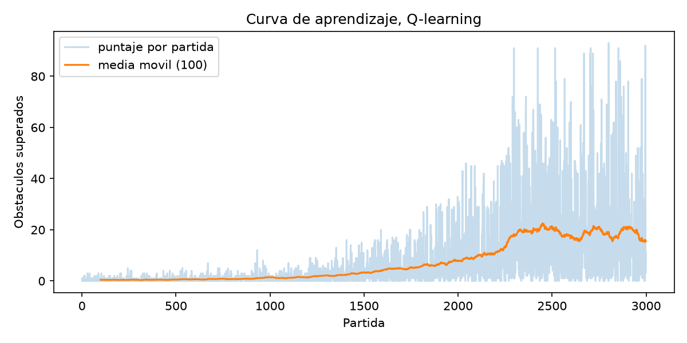

# Reinforcement Learning: el dinosaurio de Chrome con Q-learning

Un agente aprende solo a jugar el juego del dinosaurio de Chrome (el que aparece sin internet) usando **Q-learning tabular**. No usa el navegador: el juego es un simulador propio en Python, hecho solo con numpy, que corre miles de partidas en segundos.



## Cómo correrlo

```bash
pip install -r requirements.txt
python train.py              # entrena (unos 15 segundos) y genera q_table.npy, la gráfica y resultados.json
python play.py               # ver al agente entrenado jugando en la terminal
python play.py --azar        # ver a un agente al azar, para comparar
python play.py --humano      # jugar tú: espacio o W salta, S se agacha
```

## Archivos

| Archivo | Qué hace |
|---|---|
| `dino_env.py` | El juego: física, obstáculos, estado y recompensas, con `reset()` y `step(accion)` |
| `train.py` | Entrena con Q-learning, evalúa contra un agente al azar y dibuja la curva |
| `play.py` | Muestra el juego en la terminal (agente entrenado, al azar o humano) |

## Diseño

**Obstáculos:** cactus pequeño (40 %), cactus grande (35 %) y pájaro (25 %), que solo se esquiva agachándose.

**Acciones:** nada, saltar, agacharse.

**Estado:** distancia al próximo obstáculo (21 tramos de 25 px) × velocidad (4 niveles) × tipo de obstáculo (3) = **252 estados**. La tabla Q tiene 252 × 3 = 756 valores.

**Recompensas:** +1 por superar un obstáculo, −10 por chocar, −0.01 por saltar.

**Hiperparámetros:** alpha 0.1, gamma 0.95, epsilon de 1 a 0.01 (multiplicando por 0.998 en cada partida), 3000 partidas.

**Decisión clave:** el agente solo decide cuando está en el suelo. Si salta, `step()` avanza el juego hasta que aterriza y devuelve la recompensa acumulada. Una primera versión decidía en cada cuadro, también en el aire, y no aprendió (1.3 obstáculos por partida), porque el estado no incluye la altura y los saltos buenos y malos se veían iguales.

## Resultados

Evaluación en 200 partidas nuevas (otra semilla) y sin exploración:

| Agente | Obstáculos por partida |
|---|---|
| Al azar | 0.36 |
| Entrenado | **88.24** (mínimo 40, máximo 96) |

188 de las 200 partidas llegan al tope de 5000 cuadros sin chocar; las 12 restantes terminan en un cactus grande. Durante el entrenamiento el promedio solo llega a unos 20 porque el agente sigue explorando el 1 % de las veces.

## Otros ejemplos

En [`gridworld/`](gridworld/) está un ejemplo anterior de Q-learning en una cuadrícula de 4 × 4.